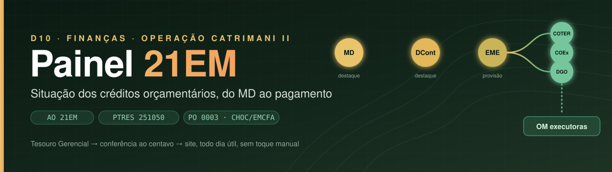
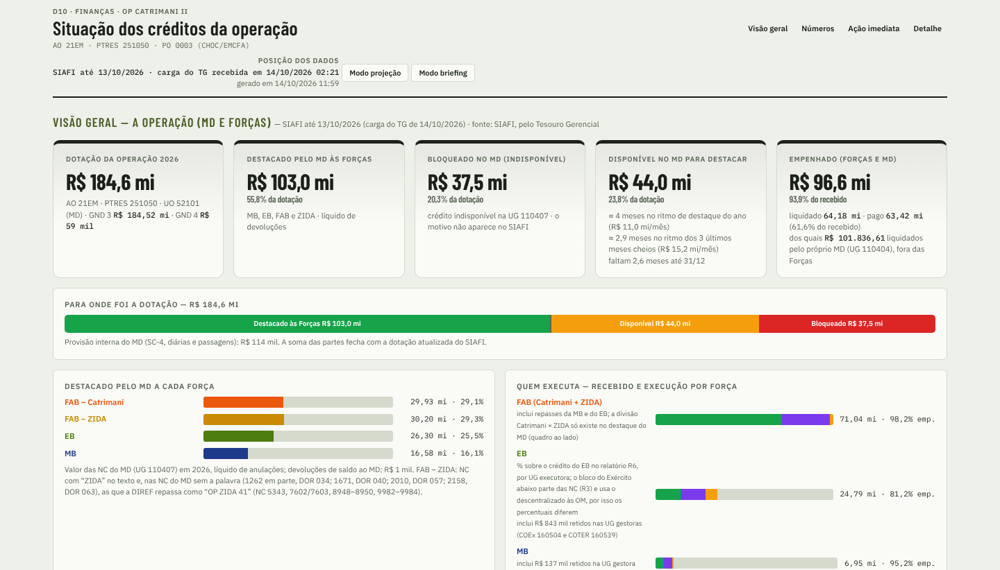
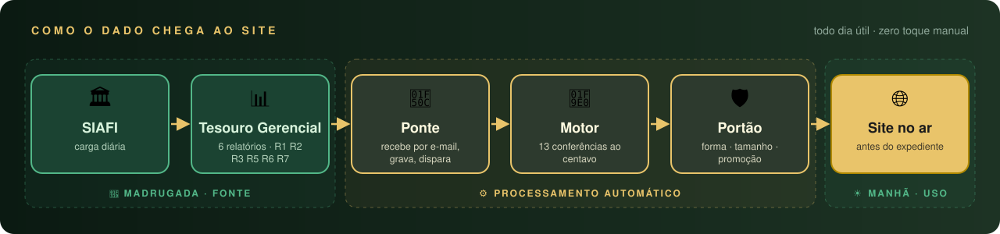
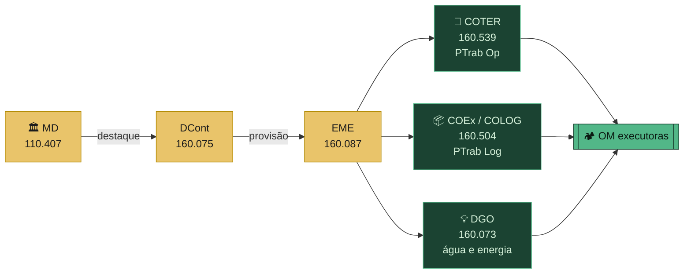

<p align="center">
  <a href="https://marcelosaldanha-1978.github.io/painel-21em-catrimani/">
    
  </a>
</p>

<p align="center">
  <a href="https://marcelosaldanha-1978.github.io/painel-21em-catrimani/"></a>
  
  
</p>

<p align="center">
  
  
  
  
  
  
</p>

<h3 align="center">Do Ministério da Defesa ao pagamento na OM —<br>cada real da Operação CATRIMANI II, conferido ao centavo, todo dia útil.</h3>

---

## 🎯 Em três frases

> **O que é** — o painel do D10 (Finanças) com a situação dos créditos da **Operação CATRIMANI II**, para a reunião diária do Estado-Maior.
>
> **De onde vem** — dos relatórios do **Tesouro Gerencial**, que chegam sozinhos depois de cada carga do SIAFI.
>
> **Por que confiar** — cada carga passa por **conferências ao centavo** antes de ir ao ar, e cada número diz se é **exato**, **conciliado** ou **estimado**.

<p align="center">
  <a href="https://marcelosaldanha-1978.github.io/painel-21em-catrimani/">
    
  </a>
  <br>
  <sub><i>Visão geral — a operação inteira (MD e Forças). Retrato da publicação de 14/10/2026 (SIAFI até 13/10/2026); os números do site mudam a cada carga.</i></sub>
</p>

---

## 🧭 O que o painel mostra

<table>
<tr>
<td width="50%" valign="top">

### 🌐 Visão geral
A **operação inteira** — dotação, destaques do MD a cada Força (EB, MB, FAB) e execução de todas elas. Depois, só o crédito do **Exército**:
- 🔀 **Fluxo do recurso** em faixas, separado por ramo desde a origem
- ⚖️ **PTrab Operacional (COTER) × PTrab Logístico (COEx)** — do pedido ao pagamento
- 🧩 **Natureza da despesa** — pedido na DOR × recebido em NC
- 🗺️ **Onde está o crédito**, por OM
- 📈 **Mês a mês** e **ritmo da execução**, dia a dia

</td>
<td width="50%" valign="top">

### 🚨 Ação imediata
O que fazer **hoje** com o crédito ainda não empenhado:
- 🔴 prazo de empenho **vencido**
- 🟠 vencendo em **até 7 dias**
- ⚡ ordens de **empenho imediato**
- 🏦 crédito **retido nos gestores**

### 🔢 Números da operação
Destacado → descentralizado → empenhado → liquidado → pago → disponível, **em cadeia**.

</td>
</tr>
</table>

### 🗂️ Detalhe, em abas

| Aba | Para que serve |
|---|---|
| 💳 **Créditos recebidos** | cada NC recebida por OM, com recolhimentos, anulações e reemissões identificados |
| 🧮 **Saldo por NC** | quanto resta em cada Nota de Crédito, com teto, prazo e ação sugerida |
| 🏭 **Executoras** | quanto cada UG recebeu de cada gestor e quanto já executou |
| 🏦 **Retido nos gestores** | crédito que o COTER, o COEx ou a DGO recebeu e ainda não repassou |
| 🔗 **Empenhos não vinculados** | empenhos sem NC de origem identificável — o que vale pedir à UG |
| 📋 **Demandas (DOR)** | cada DOR do CMA conciliada item a item com as NC que a atendem |
| 🗓️ **Restos a pagar 2025** | o exercício anterior, à parte, sem misturar com 2026 |
| 📐 **Método** | regras, limiares, conferências e glossário — tudo o que o painel faz, por escrito |

---

## ⚙️ Como o dado chega ao site

<p align="center"></p>

<div align="center">

| 🕑 Carga do TG | ⚡ Processamento | 🌐 Site no ar | 👆 Toques manuais |
|:---:|:---:|:---:|:---:|
| madrugada, após o SIAFI | minutos | **antes do expediente** | **zero** |

</div>

> [!NOTE]
> A **posição** é sempre a da última carga do SIAFI no Tesouro Gerencial, escrita no topo da página. **Não é tempo real.**

---

## 💰 A cadeia do recurso



O **ramo** de cada crédito sai do Plano Interno:

| PI | Ramo | Peça de origem |
|---|---|---|
| `OCS90001000` | 🎯 COTER | PTrab Operacional |
| `OCS90001001` | 📦 COEx / COLOG | PTrab Logístico |
| `OCS90001002` | 💡 DGO | água e energia |

> [!IMPORTANT]
> **Escopo: Ação 21EM, PTRES 251050** (PO 0003 — Atividades Operacionais CHOC/EMCFA), órgão 52121 — Comando do Exército.
> O filtro pelo **PTRES** isola a CATRIMANI II: a mesma Ação custeia a Op Sararé (PTRES 251049), que fica **fora**.

---

## 🛡️ Padrão de lastro

Toda afirmação do painel declara de onde vem:

<table>
<tr>
<td align="center" width="33%">

### 🟢 EXATO
valor lido do TG ou identidade que **fecha ao centavo**

</td>
<td align="center" width="33%">

### 🔵 CONCILIADO
vínculo **item a item**, com evidência explícita (mesma UG e valor, soma exata, DIEx citado, NC citada no empenho)

</td>
<td align="center" width="33%">

### 🟡 ESTIMADO / REGRA
rateio, convenção ou limiar do painel — **sempre rotulado**

</td>
</tr>
</table>

**Sinal vermelho, "pedir ao gestor" ou "recolher"** só com lastro **EXATO** ou **CONCILIADO** de confiança alta e valor a partir de **R$ 1 mil**. Abaixo disso, o painel diz *"confirmar"* ou *"resíduo"*. Causa só quando o dado a mostra; senão, *"a apurar"*. Pedido dentro do prazo é **em trâmite**, nunca falta.

Nenhuma versão do painel vai ao ar com achado do tipo **"expõe"** — afirmação que seria desmentida na reunião do EM — na **verificação independente**, feita por quem não escreveu o código, a partir dos CSV do TG. A data e o resultado da última verificação ficam na aba **Método**.

---

## ✅ Conferências de cada carga

<details>
<summary><b>Ver as 13 conferências</b> — o resultado de cada uma sai publicado junto com os dados</summary>

<br>

| | Conferência | O que garante |
|:---:|---|---|
| **C1** | Mesma carga | os relatórios são do mesmo dia e chegaram a até 90 min do R1 |
| **C3** | Identidade por UG | recebido + destaque − concedido − empenhado = **disponível**, ao centavo, em todas as UG |
| **C4** | Empenhos | o total por célula é igual à soma por empenho |
| **C5** | Saldo por UG·PI | a soma dos saldos por NC fecha com o crédito disponível |
| **C5b** | Saldo por ND | idem, por natureza de despesa — onde não fecha, o painel diz quanto |
| **C8** | Cadeia do recurso | MD → EME → gestores → OM pelo R3 = a calculada pelo R1 |
| **C9** | Sincronia | minutos entre o R1 e o R2 |
| **C11** | Operação inteira | destacado + provisão + disponível + indisponível = dotação |
| **C12** | EB × MD | o recorte do EB no R7 tem a mesma cadeia que o R3 |
| **C13** | DOR × NC | pedido = recebido + recolhido + em trâmite + a confirmar, ao centavo |
| **C16** | Vínculo NE → NC | empenho que parece citar NC e ficou sem vínculo |
| **C18** | Exato × estimado | quanto do prazo e do saldo por NC é exato e quanto é estimado |
| **C20** | Série diária | o ponto do dia é igual à execução calculada |

</details>

A faixa do topo diz como a carga foi publicada:

| Faixa | Significado |
|:---:|---|
| 🟩 **verde** | publicado; ressalva só informativa (ex.: resíduo cambial de centavos da CEBW, que executa em dólar) |
| 🟨 **amarela** | publicado com ressalva que pede atenção — o motivo está escrito na faixa |

---

## 📖 Como ler os números

| Termo | Leitura |
|---|---|
| **Saldo por NC** | 🟡 *estimado* — o SIAFI não guarda saldo por NC. O empenho que cita a NC no histórico é abatido dela (exato); o resto é rateado. O total por UG, PI e ND é 🟢 *exato*. |
| **Teto** | valor da NC − empenho que a cita − recolhimento vinculado. O saldo real **não passa** do teto. |
| **Prazo de empenho** | lido do texto da NC (*"empenhar até…"*, *"prazo de empenho…"*). "Empenho imediato" sem data: vale a NC de origem do EME; sem ela, **emissão + 15 dias** (convenção do D10, rotulada). |
| **Descentralizado** | o que chegou às UG executoras, já descontados os recolhimentos |
| **Empenhado → Liquidado → Pago** | reservado para a compra → entrega atestada → ordem bancária emitida |
| **Retido** | crédito que o gestor recebeu e ainda não repassou |

---

## 🔒 Limites e dados

> [!WARNING]
> Este painel é **ferramenta de acompanhamento, não fonte oficial**. Em qualquer divergência, **prevalecem o Tesouro Gerencial e o SIAFI**.

- 🙈 **CPF** em histórico de empenho é **mascarado** antes da publicação.
- 📦 Os **arquivos brutos** do Tesouro Gerencial **não** são publicados aqui.
- 🌎 Os dados exibidos são de execução orçamentária pública (SIAFI), de domínio público.
- 🤖 O site sai marcado para **não ser indexado** por buscadores.

---

## 📁 O que há neste repositório

```text
painel-21em-catrimani/
├── index.html      ← o site inteiro, com os dados embutidos (gerado a cada carga)
├── README.md       ← este arquivo
└── assets/         ← imagens deste README
```

O `index.html` é **gerado automaticamente** — não edite à mão: a próxima carga o substitui.

---

<p align="center">
  <b>D10 — Finanças · Operação CATRIMANI II</b><br>
  <sub>Painel 21EM · acompanhamento da execução orçamentária e financeira da Ação 21EM</sub><br><br>
  <a href="https://marcelosaldanha-1978.github.io/painel-21em-catrimani/"></a>
</p>
